# Bit a Bit · Lector visual de Hacker News

Lector web moderno para **Hacker News** desarrollado íntegramente con **HTML, CSS y JavaScript puro** (*Zero-Dependencies*): sin bundlers, sin frameworks, sin paso de compilación y sin base de datos propia.

---

## ¿De qué se trata Bit a Bit?

**Bit a Bit** transforma el feed clásico minimalista de Hacker News en una **experiencia de lectura visual orientada a tarjetas y lectura en panel deslizante**, manteniendo la ligereza y velocidad de una aplicación estática.

Al pulsar cualquier tarjeta (portada, título o botón de comentarios), la noticia no te saca inmediatamente del lector: **se abre en una ventana deslizante lateral (*slide-over drawer*)** donde podés ver la ficha completa de la noticia, previsualizar el sitio web dentro del mismo panel (si el destino lo permite), acceder al enlace original con el botón **"Ir al sitio original ↗"** y leer todo el árbol de comentarios sin perder tu posición en el feed.

El proyecto gira en torno a una **identidad visual binaria**:
- **Logo en código binario**: los 8 cuadrados de la cabecera representan `01000010`, el código binario de la letra **`B`** en ASCII.
- **Indicador de lectura ("Bit")**: cada historia tiene un cuadradito indicador. Mientras no la hayas abierto permanece relleno (estado `1`); al abrir su panel de lectura o comentarios, pasa a estar vacío (estado `0`) y se recuerda localmente en tu navegador.
- **Fondo matricial interactivo**: un lienzo `<canvas>` detrás de la interfaz genera un flujo suave de ceros y unos en múltiples capas de profundidad.

---

## Funcionalidades principales

- **Ventana deslizante de lectura (`<dialog>`)**:
  - Se desliza desde la derecha en escritorio (y desde abajo en pantallas móviles) con barra superior fija (*sticky*).
  - Muestra inmediatamente portada, título, dominio, puntos, autor, antigüedad y texto de la publicación (si es *Ask HN* / *Show HN*).
  - Incluye botón **"Ir al sitio original ↗"**, botón **"Ver en Hacker News ↗"** y la opción **"Previsualizar sitio aquí"** (`<iframe>` con atributo `sandbox`) para explorar el artículo sin salir del lector.
  - Debajo de la noticia carga el **árbol recursivo de comentarios** con `<details>` colapsables abiertos automáticamente hasta el **nivel 3**.
- **Secciones de Hacker News**: pestañas **Top**, **Nuevas**, **Mejores**, **Ask** y **Show** sincronizadas con la API oficial.
- **Buscador integrado**: búsqueda *full-text* mediante Algolia HN Search con paginación y retorno automático a la pestaña activa al vaciar el campo.
- **Tarjetas uniformes con portada dinámica**:
  - Previsualización automática del sitio enlazado mediante [thum.io](https://image.thum.io/) (limpiando parámetros *query* y fragmentos de la URL antes de enviarla al servicio).
  - **Portada procedural de respaldo**: si la imagen falla o la historia no tiene URL externa, se genera un gradiente determinista basado en el hash del dominio junto a su inicial.
- **Deep-linking compartible**: cada hilo actualiza la ruta (`#/item/ID`) para compartir enlaces directos y navegar hacia atrás o adelante con el historial del navegador (`hashchange`).
- **Scroll infinito, caché y cancelación de red**: carga automática por lotes de 20 historias (`IntersectionObserver` + botón **"Cargar más"**), caché en memoria (`Map`) para no repetir peticiones al cambiar de pestaña y cancelación de solicitudes pendientes con `AbortController`.
- **Tema claro/oscuro y atajos de teclado**: respeta `prefers-color-scheme`, persiste la elección en `localStorage` y permite usar **`/`** para enfocar el buscador y **`T`** (o **`Alt+T`**) para alternar el tema.
- **Estados de interfaz y accesibilidad**: skeletons proporcionales a las tarjetas para evitar saltos de diseño, manejo de errores con botón **"Reintentar"**, foco visible (`:focus-visible`), atributos dinámicos `aria-pressed` y `aria-busy`, regiones `aria-live="polite"` / `role="status"` y soporte para `prefers-reduced-motion`.

---

## Arquitectura y flujo de datos

El lector utiliza una **arquitectura híbrida sin backend** combinando dos APIs públicas y gratuitas (sin necesidad de *API key*):

1. **Hacker News Firebase API** (`/v0/{top|new|best|ask|show}stories.json` e `/v0/item/{id}.json`):
   - Obtiene la lista de IDs de cada sección y pide los metadatos por **lotes de 20 elementos en paralelo con `Promise.all`**, resolviendo el problema N+1 de forma controlada y paginada, con caché en memoria (`itemCache` y `storyMap`).
2. **Algolia HN Search API** (`/api/v1/search` y `/api/v1/items/{id}`):
   - Alimenta el buscador por palabra clave.
   - Permite descargar el **árbol completo de comentarios de una historia en una sola petición HTTP**, evitando cientos de llamadas recursivas por cada `kid` contra Firebase.

```mermaid
flowchart LR
  UI["Interfaz (index.html + app.js)"] -->|"Tabs: Top / New / Best / Ask / Show"| FB["HN Firebase API"]
  FB -->|"Lotes de 20 con Promise.all + itemCache"| NORMF["Normalizador normF()"]
  UI -->|"Buscador (#sf)"| ALGS["Algolia Search API"]
  ALGS -->|"Resultados paginados"| NORMA["Normalizador normA()"]
  NORMF --> CARDS["Grilla de Tarjetas (#list + storyMap)"]
  NORMA --> CARDS
  CARDS -->|"Clic en tarjeta -> openItem(id)"| DRAWER["Ventana Deslizante (<dialog>)"]
  DRAWER -->|"Solicita comentarios (#/item/ID)"| ALGI["Algolia Items API"]
  ALGI -->|"Árbol completo en 1 petición"| CLEAN["Sanitizador clean() + comment()"]
  CLEAN --> DRAWER
```



---

## Seguridad (Sanitización XSS)

Los comentarios y textos de Hacker News contienen HTML sin procesar. Antes de insertarlos en el DOM, la función `clean()` en [`app.js`](app.js) procesa el contenido en un documento aislado con `DOMParser` siguiendo una **lista blanca estricta**:

- **Etiquetas permitidas**: `P`, `I`, `B`, `EM`, `STRONG`, `A`, `PRE`, `CODE`, `BR`. Cualquier otra etiqueta (como `<script>`, ``, `<iframe>`, etc.) se reemplaza por su texto/hijos o se descarta.
- **Atributos y enlaces**: se eliminan todos los atributos salvo `href` en enlaces `<a>`, validando que el protocolo sea exclusivamente `http://` o `https://` (bloqueando esquemas `javascript:`) y añadiendo `target="_blank"` y `rel="noopener noreferrer nofollow"`.
- **Validación de URLs y escape**: `safeUrl()` valida las URLs externas de noticias antes de enlazarlas o cargarlas en el `<iframe>` embebido (`sandbox`), y `esc()` escapa cualquier campo de texto plano en las plantillas.

---

## Animación de fondo y rendimiento

La función `bg()` en [`app.js`](app.js) renderiza el fondo matricial sobre `#bg` priorizando la fluidez y el bajo consumo de recursos:

- **Capas de profundidad (*parallax*)**: cada partícula (`0` o `1`) posee un factor de profundidad `z` (`0.4` a `1.0`) que regula simultáneamente su tamaño, opacidad y velocidad de ascenso.
- **Oscilación sinusoidal y cambio de bits**: deriva horizontal suave (`Math.sin`) y mutaciones aleatorias esporádicas (`0` ↔ `1`) acompañadas de un breve pulso de opacidad.
- **Interacción sutil con el cursor**: las partículas cercanas al puntero dentro de un radio reactivo se desplazan suavemente y aumentan ligeramente su brillo.
- **Optimización y ahorro de batería**:
  - Reescalado proporcional de partículas cuando solo cambia la altura de la ventana (evitando reinicios bruscos en móviles al ocultarse la barra del navegador durante el scroll).
  - Cachea el color `--ac` mediante `MutationObserver` sobre `data-theme`, evitando invocar `getComputedStyle` en cada frame.
  - Se detiene automáticamente cuando la pestaña queda oculta (`visibilitychange` / `document.hidden`).
  - Se mantiene estática si el usuario tiene activado `prefers-reduced-motion: reduce`.

---

## Estructura del proyecto

| Archivo | Responsabilidad |
| :--- | :--- |
| [`index.html`](index.html) | Estructura semántica, favicon SVG binario, barra de herramientas (`.toolbar`), grilla y ventana deslizante `<dialog>`. |
| [`style.css`](style.css) | Sistema de diseño con variables CSS, temas claro/oscuro, grilla responsive, drawer lateral/móvil, skeletons y accesibilidad. |
| [`app.js`](app.js) | Lógica de datos, caché (`itemCache` / `storyMap`), `AbortController`, sanitizador XSS, canvas y controlador (`init()`). |
| [`test.js`](test.js) | Suite de pruebas unitarias con `assert` nativo de Node.js. |
| [`package.json`](package.json) | Script `npm test` y dependencia de desarrollo opcional (`jsdom`) para el test del sanitizador. |
| [`README.md`](README.md) | Documentación técnica y guía de uso del proyecto. |

---

## Cómo ejecutarlo

Al ser un proyecto estático, podés iniciarlo de cualquiera de estas maneras:

1. **Directamente en el navegador**: abrí [`index.html`](index.html).
2. **Con servidor local** (recomendado):
   ```bash
   npx serve .
   ```
   *(También funciona con Live Server, `python -m http.server` o cualquier hosting estático como GitHub Pages, Netlify o Vercel).*

### Ejecutar pruebas

La suite de pruebas utiliza el módulo nativo `assert` de Node.js:

```bash
npm test
# o directamente:
node test.js
```

> **Nota sobre el test del sanitizador**: `clean()` depende de `DOMParser`. Si querés incluir la prueba unitaria de sanitización XSS en Node.js, ejecutá `npm install` (instala `jsdom` como `devDependency` sin afectar la app web estática); de lo contrario, `test.js` ejecutará el resto de las pruebas y omitirá ese bloque sin fallar.

---

## Limitaciones conocidas

- **Previsualización embebida (`iframe`)**: algunos sitios externos envían cabeceras `X-Frame-Options` o `Content-Security-Policy` (`frame-ancestors`) que impiden cargarlos dentro de un `<iframe>`; en esos casos podés abrirlos directamente con **"Ir al sitio original ↗"**.
- **Disponibilidad de miniaturas**: las portadas dependen del servicio gratuito externo `thum.io`; ante bloqueos, límites de tasa o ausencia de URL externa, la tarjeta muestra automáticamente la portada procedural generada con el dominio.
- **Desfase temporal en Algolia**: los puntajes y conteos de comentarios devueltos por Algolia pueden presentar una leve diferencia respecto a los valores en tiempo real de Firebase.
- **Hilos masivos**: publicaciones con miles de comentarios anidados pueden tardar unos instantes adicionales al construir los nodos `<details>` en el DOM.

## Ideas futuras

- Marcadores o favoritos persistentes separados del historial de lectura.
- Filtro rápido por dominio.
- Soporte offline e instalabilidad como **PWA**.
